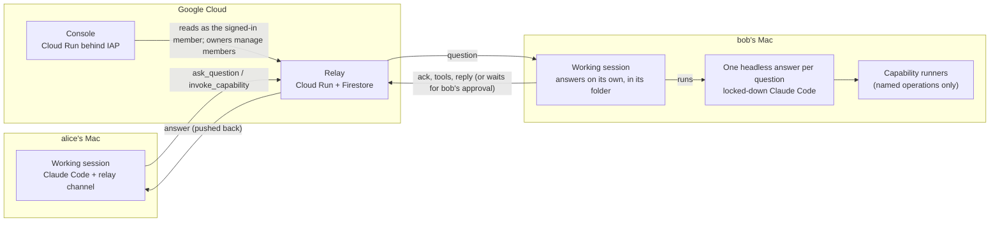

# Team relay

**Let your team's Claude Code sessions talk to each other.**

Ask a teammate's Claude a question from your own session and get the answer pushed back into
it. Or ask them to run one of a small set of named, parameterised operations ("query staging
for the last 20 failed orders") without ever handing anyone a shell. A hosted console shows
who is connected and every request's round trip as it happens.


<sub>The console in demo mode, with a synthetic team.</sub>

## How it works



- **The relay** is a small stateless FastAPI service. Firestore holds a mailbox per member,
  so nothing is lost when a laptop sleeps: clients resume from their last acknowledged
  message. Requests carry idempotency keys, deadlines and request IDs; broadcasts fan out.
  Every message is audited (hash and length, never the text).
- **The plugin** gives Claude Code a *channel*: an MCP server that pushes teammates' messages
  into the session as `<channel>` events and adds tools to ask, invoke and reply.
- **Your working session also answers.** Your normal *working session* asks and receives
  answers, and answers your teammates on its own, within the folder you are working in: for
  each question it acknowledges at once, then runs a short-lived, locked-down headless Claude
  in that folder (no Bash, Write, Edit or web; none of your hooks, plugins or settings; your
  normal login). It reads the folder without asking; everything else waits for you. An
  ordinary answer ships automatically. A read outside the folder, every capability run, an
  answer it flags as sensitive or unsure, one the secret screen flags, and any answer that
  needed your approval on the way wait until you decide in a dialog
  (`/team-relay:approvals`), and are denied if you do not. Credential files stay unreadable.
  Because the question is acknowledged first, the asker learns "no response yet" instead of
  waiting forever. A question sent while no session of yours answers waits for one, and your
  working session tells you, as do `whoami`, the session's first line and the console. The
  separate, manual *answering session* of earlier versions is still there, as an option.
- **Capabilities** are declared in one manifest (`plugin/manifest.yaml`): named operations
  whose every parameter is an enum, a bounded number, a boolean, or a length-capped string
  matched by an RE2 pattern. Never free-form SQL, shell or paths. The same file drives the
  tools the answering session exposes, what teammates discover, and the settings
  `/team-relay:answering` lists. Production data is a separate opt-in that is off by default.
- **The console** shows presence for both sessions of every member, a live list of requests
  with each hop (sent, delivered, acknowledged, tools used, answered, returned), who is
  waiting for a teammate to allow access, which folders each member shares, and a detail
  sheet with timings. Everyone sees the metadata; question and answer text is visible only
  to the people in that request. It marks a member whose answering session stopped with
  questions waiting, and tells you when some wait for yours. Team owners invite and remove
  members there, by Google email. One console serves every team you are on: a switcher in its
  header moves between them.
- **Teams** are created by anyone who signs in with Google, on the sign-in page or in the
  console (see "Teams" below). Relay admins see and delete every team from the console's
  admin page.

## Security model

| Concern | What the system does |
|---|---|
| Who is speaking | Each device signs in once with Google through the relay (`/team-relay:login`) and gets its own relay-issued credential, bound to one member of one team. The relay stores only its hash, expires it 90 days after last use, revokes it on logout or when the member is removed, and derives the sender from it. Nothing in a request body can claim to be someone else. The hosted console and gcloud users still use verified Google ID tokens. |
| Signing in | Loopback and PKCE, in the style of RFC 8252; no device codes, so there is no code to phish. The one-time code only ever goes to a listener on 127.0.0.1 on your own machine within 5 minutes, and is useless without the verifier the plugin holds; the listener answers anything but the right callback (wrong Host, path or state) with 404 and keeps waiting. The relay redirects nowhere else. Which relay you sign in to is never the model's choice: `/team-relay:login` takes no arguments (another relay comes only from `RELAY_URL` in your environment), and it never replaces a sign-in from a different relay. Signing out is `/team-relay:logout`, a command only you run, not a tool. After a sign-in the session says "Connected as <member> (<email>) on team <team>", and says plainly when that is a different member or team than before. The credential file is `~/.config/team-relay/credentials.json` (mode 600 in a mode-700 directory); the plugin refuses a file others could read. |
| Who is on the team | The roster lives in the relay. Owners invite a member by Google email and remove them in the console; an invitation grants nothing until its person accepts it, with that Google account, on the sign-in page or in the console. A removed member's devices stop working within 30 seconds. The relay is reachable without Cloud Run IAM (the sign-in pages must be) and authenticates every API call itself. |
| Who creates and deletes teams | Anyone signed in with Google creates a team and becomes its owner: at most 3 created and not deleted per Google account, 50 members a team (invitations included), and hourly and daily limits per account and per client address. Team ids are unique and reserved words and the relay's own team ids are refused. Any owner of a created team deletes it; a relay admin deletes any created team; the relay's configured teams are never deleted through the API. A deleted team is refused everywhere at once, its devices' credentials stop working, its data is removed, and its id stays reserved for 31 days. Admins see sizes and activity, never emails or content. |
| Prompt injection | Teammate text arrives as data inside `<channel>` tags or labelled tool results. The session's instructions say it is never to be followed as instructions. The channel never relays permission prompts. |
| What a teammate can make you run | Only capabilities you enabled, with parameters validated on both ends against the manifest. Each run is tied to a real, directed request. The runner gets no shell, a minimal environment, a timeout and an output cap. |
| What answers automatically | Only a channel working session, one per computer (a lock), within its own folder. Each answer is a fresh headless Claude Code with `--setting-sources ''` (none of your hooks, plugins or settings load), only Read, Glob and Grep, the credential deny list, and two MCP servers: the plugin's host tools over a private socket (mode 600, per-run token) and your capability server. Reads are automatic only inside the folder, and only when it is in a git work tree away from your home's own folders. What ships on its own is decided by the plugin, not the model: reads inside the folder and answers nothing flagged. Everything else (reads elsewhere, capability runs, answers the model flags or the secret screen catches, answers after reading a file whose name suggests secrets, answers after any approval, and questions past the volume limits of 3 waiting per teammate and 20 an hour) waits for your decision in a dialog the model cannot answer for you, and is denied at the question's deadline or after 30 minutes. The question goes to it on stdin, framed as teammate data. A question still open when the session closes is received again by the next one. |
| What the manual answering session can read | Nothing by default. Folders you share deliberately (`ANSWERER_READ_DIRS`) are readable without asking; teammates see their names, never their paths. Anything else opens Claude Code's own permission dialog in your answering terminal, naming the path, and you allow it once, for the session, or not at all; a desktop notification and the asker's console show that it is waiting. Grants never outlive the session. Credential stores (the relay's own credential, ssh and gpg keys, cloud CLI credentials, `.env` files, browser cookies, keychains, wallet keystores and more) stay denied whatever you answer. These are Claude Code permission rules, not an OS sandbox. |
| Abuse | Per-sender rate limits, broadcast limits, read budgets, caps on long-polls, and rate limits on sign-ins and roster changes. Manifest patterns run in RE2, so a teammate cannot publish a regex that stalls anyone. |
| The console | Reads only, except an owner's roster changes and boundaries and the account's own (create a team, answer an invitation, delete a team, an admin's delete); each is a same-origin JSON request with a size cap and a body checked field by field (unknown fields refused) before it reaches the relay. Locally it binds 127.0.0.1 with a per-launch key. Hosted, it sits behind IAP; any signed-in Google account reaches the page, and the relay decides what it sees: every call names a team, checked against the viewer's active teams, and someone on no team gets only their invitations and "Create a team", no data, not even the join details. When it creates a team for a viewer it tells the relay a salted hash of the viewer's address, so the per-address limit holds through it. |

## Joining a team

On a Mac, the simple way needs no Terminal: in the Claude app (Claude Code), add the team
tools, then type `/team-relay:setup`. A page opens in your browser, on your own Mac: sign in
with Google and choose your team (accept the invitation there), accept what the team shares,
add the folders your Claude answers from with the Mac's own folder chooser (every folder you
use for the team: your copies of its GitHub projects, your Google Drive for desktop folders,
shared documents), leave "Background answering" on (it answers teammates' questions from your
folders even when Claude is closed), and click Done. The page says "All set. Go back to Claude."
The plugin gets the Node.js it needs by itself.

If you prefer Terminal: open your team's page (the link in your invitation), click "Sign in
with Google", accept the invitation, and follow the card "Join in 2 minutes": open Terminal, paste the one setup line
it shows, answer its questions (it gets what it needs, Node.js included, and opens the Mac's
own folder chooser), then click Accept on the page. The Setup page shows what is left in plain
words. The steps below are the manual way, for developers and other systems.

You need [Claude Code](https://code.claude.com) 2.1.280 or newer and Node.js 22.12 or newer, and
the team owner must have invited your work Google account (or you create a team yourself,
below). Then, in Claude Code:

1. **Install the plugin** from the `team-relay-dev` marketplace. No questions to answer.
   ```
   /plugin marketplace add <github-owner>/team-relay
   /plugin install team-relay@team-relay-dev
   ```
   `<github-owner>` is the account this repository lives under (ask your team's owner). While channels are in research preview, start Claude Code with
   `claude --dangerously-load-development-channels plugin:team-relay@team-relay-dev`
   (for a team on another relay than the plugin's default, put `RELAY_URL=https://<relay>`
   in front). Teammates' answers appear only in a
   session started that way. The plugin is installed for your user, so your other Claude Code
   sessions have its tools too, but they never read your answers (that would lose them): they
   say so, and your answers wait for a session with the channel.
2. **Sign in with your work account:** `/team-relay:login`. Your browser opens on the relay
   (the session also shows the link, in case no tab opened); sign in with the Google account
   you were invited with, accept the invitation (the page lists it with Accept and Decline),
   pick the team, done. The session waits for it and says "Connected as <you> (<your email>)
   on team <team>".
3. **Say where your clones live, and accept the team's boundaries:** `/team-relay:folders`
   adds your repository roots (for example `~/DEV/<org>`), searched three levels deep. Only
   clones of the team's whole GitHub orgs and of the repositories it lists count (matched by
   their `origin`), and in them only the files git tracks (no `.env`, notes or build output).
   If the team allows it, the same command adds folders of your own. It also shows you the
   team's boundaries (its GitHub orgs and repositories, shared-drive folders and whether
   members may add folders) and asks you to accept them: your session answers only from what is both
   in the team's boundaries and accepted by you. Until you accept, teammates' questions are
   declined with "<you> hasn't set up answering for this team yet". When an owner narrows the
   boundaries, that applies at once. When an owner widens them (a new org or repository, a new
   folder or drive, member folders turned on), your session says "<team>'s boundaries changed … run
   /team-relay:folders to accept" and keeps answering from what you accepted before; run the
   command again to see exactly what is added and accept it.
4. **Connect Google Drive** when the team's boundaries list shared-drive folders: Google Drive
   for desktop signed in with your work account, then `/team-relay:drive` (a Google sign-in in
   the browser, read-only; the token stays in your Mac's Keychain and never goes to the relay;
   run it again to disconnect). Your Mac finds each folder in Drive for desktop's `Shared
   drives` by its Drive id, not its name, so a renamed folder is still found.

Your Setup page in the console lists anything of the team's that your Mac did not find: a
repository with the `git clone` line to get it (clone it under one of your roots), or a Drive
folder with what to check (Drive for desktop signed in with your work account, and access to
that shared drive). `setup-cli status` prints the same lines. Your Mac reports only which of the
team's own items it is missing, never a path or a local folder name; owners see each member's
missing items, other members only their own. A source you do not have is simply skipped.

That is all. In a team with boundaries (Team settings in the console), questions on the
team's topic are answered on their own from the allowed clones, drives and folders, with no
dialogs; anything else is declined, and teammates see what you can answer from. In a team
without them, answering works as before: within the folder you started the session in, and
when an answer needs you, the session says so and `/team-relay:approvals` shows it in a
dialog. To offer capabilities, put their settings (`/team-relay:answering` lists them) in the
environment you start Claude Code with.

`/team-relay:console` opens the console on your own machine; `/team-relay:logout` signs this
computer out (revokes its credential, then deletes it); `whoami` is a tool in your working
session. Optional: `/team-relay:answering` prints the command for a separate, manual answering
session in a terminal of its own (reads nothing by default; `ANSWERER_READ_DIRS` shares
folders); start your working sessions with `TEAM_RELAY_AUTO_ANSWER=0` if you use it, since
only one answerer runs per computer. Details, including writing capability runners:
[`plugin/README.md`](plugin/README.md).

## Teams

- **Create a team.** Anyone who signs in with Google can: on the sign-in page (an account on
  no team sees "You're not on a team yet" with a small form; one on teams has "Create a new
  team" below the chooser), or in the console (the team switcher's "Create team"). Give it a
  name; the id is made from the name and can be edited (lower-case letters, digits and `-`,
  3 to 32 characters; it cannot change later); pick your member id. You become its owner and
  the sign-in continues with the new team. **Each Google account may have created at most 3
  teams** that are not deleted; deleting one frees its slot. A team has at most 50 members,
  open invitations included.
- **Invite.** Owners invite teammates by Google email in the console's Members panel. The
  person accepts (or declines) when they next run `/team-relay:login`, or in the console's
  team switcher; until then the entry shows as Invited, grants nothing, and the owner can
  withdraw it. Teammates listed in the relay's team file are members from the start.
- **Set its boundaries.** In the console's Team settings, an owner sets what the team talks
  about (its topic), the GitHub repositories and shared-drive folders its members answer from,
  and whether members may add folders of their own. **GitHub:** with the relay's GitHub App
  installed on the org (below), the GitHub picker lists the org's repositories; tick single
  ones or the whole org (every repository of it, today's and future ones). Without the app, paste
  `https://github.com/<org>` or `https://github.com/<org>/<repo>`. **Drive:** the Drive picker
  opens Google's own picker on a page of its own, signed in as you, for shared-drive folders or a
  whole shared drive (the page never sends your Google token to the relay or the console, and
  forgets it when it closes); or paste a folder's `drive.google.com/drive/folders/…` link.
  Drives typed by name before this change are kept as "matched by name" until you re-pick them;
  no new name can be added, and members accept a re-picked drive once more. Narrowing a whole
  org to some of its repositories needs no new acceptance; adding a repository or a folder does.
  The members view shows each member's missing items by name. Inside them answers go out without approval
  dialogs; off-topic questions are declined. Members see them read-only; a save made from an
  older version than the current one is refused, and the form shows the latest. Right after
  creating a team the console opens there. Until they are set, answers need each member's
  approval, as before. Each member accepts the boundaries once in `/team-relay:folders`
  (and again when an owner widens them) before their session answers from them.

  **Accepted risks.** Boundaries are a deliberate trade-off; know these before you set them:
  - Everyone on the team may get anything inside the boundaries, whatever their own access.
    A teammate who cannot open a repository on GitHub, or a folder on the shared drive, can
    still get an answer drawn from it. Sharing the team's work inside the team is the point.
  - The check for secrets in answers looks for known patterns. A teammate who talks the
    answerer into disguising a secret (spelling it out, encoding it) could get one past it.
    Credential files and files git does not track are never read, and the repositories' own
    secret scanning keeps the tracked files free of secrets.
  - The relay's GitHub App lists the repository names of the orgs in `GITHUB_ORGS` to the
    owner of **any** team on the relay (never their contents). A relay that serves one
    organisation's own teams accepts that; bind orgs to teams before another organisation's
    team joins it.
  - The Google Drive sign-in (read-only, the narrowest access Google offers for reading
    shared drives) is kept in your Mac's login Keychain. Programs running as you can read it
    without asking, like any of your files. The answerer itself cannot run commands.
- **Delete a team.** Any owner of a created team deletes it in the console's Team settings,
  by typing its id. Everyone loses access at once and its data is removed; the id stays
  reserved for 31 days. The teams in the relay's team file cannot be deleted this way.
- **Admins.** The relay's team file names its admins (`admins: ["google:<email>"]`). An
  admin's console has an admin page: every team with its status, members, owners, when and
  by whom it was created and its last activity (never emails or content), a page at a time,
  and Delete after typing the team's id. Being an admin reads no team's data.
- **The hosted console serves every team** the viewer is on: the switcher in its header
  moves between them and remembers the last one in the browser. It reads the relay as a
  delegate with `team: "*"` and `manage-teams` (`relay/README.md`, "The any-team delegate").

## Run your own relay

Everything deploys to one Google Cloud project, in resources named `team-relay*`:

1. **Configure.** `cp config/deploy.example.env config/deploy.local.env` (project, region,
   team) and `cp config/team.example.yaml config/team.local.yaml`: your team and its seed
   owner (a member id and a Google email). Everyone else is added in the console.
2. **An OAuth client for the sign-in.** In the Cloud Console create a *Web application* OAuth
   client with the redirect URI `https://<relay-host>/v1/login/callback`, and set the OAuth
   consent screen to *In production* (the scopes are only `openid` and `email`, so Google
   does not review it, and no test-user list is needed).
3. **Deploy.**
   ```bash
   OAUTH_CLIENT_FILE=~/Downloads/client_secret_....json \
     bash scripts/gcp-bootstrap.sh   # Firestore DB, service accounts, registry, secrets (idempotent)
   bash scripts/deploy.sh            # the relay (the app authenticates every call)
   bash scripts/smoke.sh             # 401 without credentials, 400 for a bare login start
   bash scripts/deploy-console.sh    # the hosted console behind IAP
   ```
4. **Invite.** Sign in as the seed owner, open the console's Members panel, invite each
   teammate's Google email, and send them the two steps above. Anyone can also create a team
   of their own (see "Teams"); name the relay's admins in the team file's `admins`.

The OAuth client's id and secret live only in Secret Manager. Both `*.local.*` files are
git-ignored: real identities never enter the repository. The plugin's default relay URL is
in `plugin/relay.default.json`; teams on another relay start Claude Code with
`RELAY_URL=https://<relay>` in front and then run `/team-relay:login`.

## Deploying on your own domain

One address, say `https://team.example.com`, serves both: `/` and `/login` (a public sign-in
page), `/v1/*`, `/healthz` and `/setup` go to the relay (which signs people in itself),
everything else to the console behind IAP. The sign-in page's button leads to `/start`, which
takes a member to their Setup page until it is done and to Ask after that; the team view lives
at `/team` ([sign-in page](docs/SIGNIN-PAGE.md)). A global external Application Load Balancer
with a reserved static IP and a Google-managed certificate sits in front; both Cloud Run
services take traffic only from it.

1. **Settings.** In `config/deploy.local.env` set `PUBLIC_HOST=team.example.com`,
   `IAP_ACCESS` (who may pass IAP to the console: `domain:example.com`, `group:<email>` or
   `user:<email>`, comma-separated; `allUsers` is refused, and anyone not listed is removed
   on each run) and `ALLOWED_DOMAINS=example.com` (comma-separated lower-case domains: the
   relay then refuses every Google account outside them, on every route). Without
   `ALLOWED_DOMAINS` any Google account can sign in and use the relay's API (create a team,
   for one); `deploy.sh` warns, and with `PUBLIC_HOST` set it stops unless you also set
   `CONFIRM_OPEN_RELAY=1` to choose that on purpose. Optionally `BRAND_NAME="Example Co"`
   (1 to 40 letters, digits, spaces and `& . , ' -`): the sign-in page then says "Use your
   Example Co Google account" (`RELAY_BRAND_NAME` on the relay); unset, it says just "Team
   Relay".
2. **The Web OAuth client** (step 2 above) gets two redirect URIs:
   `https://team.example.com/v1/login/callback` (the relay's sign-in) and
   `https://iap.googleapis.com/v1/oauth/clientIds/<client id>:handleRedirect` (IAP). With a
   Google Workspace organisation, set the consent screen to *Internal*: only your domain's
   accounts can sign in at all.
3. **Optional, Drive:** a *Desktop app* OAuth client in the same project for
   `/team-relay:drive` (scope `drive.readonly`). Its JSON goes in once as
   `DRIVE_CLIENT_FILE`; the relay serves its id to active members and mounts it from Secret
   Manager.
4. **Optional, picked sources** ([docs/PICKERS-SPEC.md](docs/PICKERS-SPEC.md) §13). *GitHub:*
   create a GitHub App in the org (Settings, Developer settings, GitHub Apps): webhook off, no
   user sign-in, Repository permission **Metadata: Read-only** and nothing else, no events,
   "Only on this account"; note its App ID and slug, generate a private key, and install it on
   the org. Run `GITHUB_APP_ID=… GITHUB_APP_SLUG=… GITHUB_APP_KEY_FILE=<the .pem> bash
   scripts/gcp-bootstrap.sh` (stores the secret `team-relay-github-app`; the key is never
   printed), then delete the `.pem`. Set `GITHUB_ORGS=<org login>[,…]` in
   `config/deploy.local.env`: the only orgs owners may pick from and the only installations the
   relay lists; `deploy.sh` refuses the app without it. Optionally
   `ALLOWED_SHARED_DRIVES=<shared drive id>[,…]` limits the Drive folders owners may pick.
   *Drive picker:* a *Web application* OAuth client "team-relay picker" with the JavaScript
   origin `https://team.example.com` and no redirect URI, and an API key restricted to the
   websites `https://team.example.com/*` and `https://docs.google.com/*` and to the Google
   Picker API. Run `PICKER_CLIENT_ID=… PICKER_API_KEY=… bash scripts/gcp-bootstrap.sh` (stores
   `team-relay-picker` with the project number, and enables the Picker and Drive APIs). Without
   these owners paste links instead.
5. **Deploy**, in this order:
   ```bash
   OAUTH_CLIENT_FILE=~/Downloads/client_secret_web.json DRIVE_CLIENT_FILE=~/Downloads/client_secret_desktop.json \
     bash scripts/gcp-bootstrap.sh     # also enables the Compute API and stores the Drive client
   OAUTH_CLIENT_FILE=~/Downloads/client_secret_web.json \
     bash scripts/deploy-lb.sh         # IP, certificate, NEGs, backends, IAP, URL maps, :443 and :80
   bash scripts/deploy.sh              # the relay, reachable only through the load balancer
   bash scripts/deploy-console.sh      # the console, IAP now on the load balancer's backend
   ```
6. **DNS.** `deploy-lb.sh` ends by printing the one record to add, `A team → <IP>` (TTL
   600). The certificate goes active once the name resolves (up to an hour); then run
   `bash scripts/smoke.sh`, which also checks that the `run.app` URL answers nothing from
   outside, the console (and its Drive picker page, `/pick/drive`) asks for a sign-in and plain
   http redirects to https.

`deploy.sh` never quietly drops a setting: when the live relay has one (say
`RELAY_PLUGIN_MARKETPLACE`, `RELAY_ALLOWED_DOMAINS`, `RELAY_BRAND_NAME`, `RELAY_GITHUB_ORGS` or
a mounted secret) that this deploy would remove, because it is unset in
`config/deploy.local.env` or its secret was not found, it stops and names it. Set it again, or
run with `CONFIRM_REMOVE=<NAME>[,<NAME>]` to remove it on purpose. It reads only the names of
the live settings, never their values.

What changes with `PUBLIC_HOST` set: both services get ingress
`internal-and-cloud-load-balancing`; the relay's public URL, sign-in callback and token
audience become `https://team.example.com`, and the console calls the relay there too (a
`run.app` call would be refused). IAP moves from the console's Cloud Run service to its
backend service, with your OAuth client and `IAP_ACCESS`; the console checks IAP's signed
header against that backend's audience, and only IAP's service agent may invoke the console
service. The relay's backend has no IAP. Both count each viewer's address as the load
balancer writes it (`RELAY_FORWARDED_FOR_HOPS=2`, `CONSOLE_PROXY_HOPS=2`, set by the
scripts); a console on a host that is not `run.app` refuses to start without its hop count. Requests for any other host name (the bare IP)
are redirected to `PUBLIC_HOST`. Every script checks before it changes anything, so a re-run
changes nothing that is already right. Without `PUBLIC_HOST`, both services answer on their
`run.app` URLs as before.

## Repository

| Path | What |
|---|---|
| [`relay/`](relay/README.md) | The relay: FastAPI, Firestore and in-memory stores behind one contract test suite. |
| [`plugin/`](plugin/README.md) | The Claude Code plugin: channel server (with the automatic answerer), capability server, manual answering-session launcher, local and hosted console server. |
| `console/` | The console UI: React, Vite, TypeScript, Tailwind, shadcn/ui. It builds into `plugin/dist/console`. |
| `schema/` | The capability manifest's JSON Schema. |
| `docs/` | The contracts, milestone by milestone, with dated corrections: [M1](docs/M1-SPEC.md) (relay and channel), [M2](docs/M2-SPEC.md) (deploy, identity, console), [M3](docs/M3-SPEC.md) (hosted console), [M4](docs/M4-SPEC.md) (granted reads), [M5](docs/M5-SPEC.md) (install and sign in), [M6](docs/M6-SPEC.md) (members in the console), [M7](docs/M7-SPEC.md) (questions waiting), [M8](docs/M8-SPEC.md) (automatic answers within the folder), [M9](docs/M9-SPEC.md) (anyone can create a team), [M10](docs/M10-SPEC.md) (team boundaries, answers without dialogs, one address), [M11](docs/M11-SPEC.md) (answering in the background, guided joining, asking from the browser), [the sign-in page](docs/SIGNIN-PAGE.md). |
| `scripts/` | Emulator, tests, bootstrap, deploy (relay, console, load balancer) and smoke checks. |

## Development

```bash
bash scripts/test-relay.sh                               # relay suite against the Firestore emulator (Docker)
(cd plugin  && pnpm install && pnpm typecheck && pnpm test)
(cd console && pnpm install && pnpm typecheck && pnpm test)
bash scripts/e2e.sh                                      # emulator + relay + the real plugin servers, end to end
plugin/bin/console --demo --open                         # the console with synthetic teams
```

The end-to-end suite plays Claude Code over MCP. It covers directed questions, broadcasts
with "no response yet", capability calls with progress, resuming after a crash,
idempotency, identity rules, presence, delivery times, tool events, the console's masking,
the whole sign-in against a fake Google, an owner inviting a member who accepts and removing
them, automatic answering with a stub `claude` (an answer inside the folder ships; a read
outside it, a flagged answer and a capability call wait for approval; a lapse sends nothing),
and teams: a new account creating a team on the sign-in page, inviting a member who accepts
and signs in, the two exchanging a question, and an admin deleting the team, after which both
are refused.

## Status

Working end to end and deployed for a team of three. Known limits:
- Custom channels need Claude Code's development flag during the channels research preview.
  Claude Code does not tell a channel server whether its session was started with the flag,
  so the plugin reads the `claude` process's command line (`plugin/README.md`, "Sessions
  without the channel"). If that check gets it wrong, `TEAM_RELAY_CHANNEL=1` or `0` in the
  environment Claude Code starts with decides.
- gcloud sign-in (`RELAY_AUTH=google`) still uses gcloud's own ID-token audience, so a token
  sent to some other service could be replayed to the relay within its hour. The device
  credential from `/team-relay:login` does not have this problem.
- The answerers' read restrictions are Claude Code permission rules, not an OS sandbox: the
  folder you work in, and what you share or allow, is readable, and the deny list covers the
  usual credential stores, not every secret on a machine; the secret screen is a pattern
  check, not a guarantee.
- Anything that runs as you can answer an approval dialog for you: an `Elicitation` or
  `ElicitationResult` hook in your own, a trusted project's or a plugin's settings;
  auto-allowed `Bash` in the working session (an allow rule, auto mode or
  `--dangerously-skip-permissions`), with which its model could act as you; or (only where
  Claude Code offers no dialogs and the local page is used) a process that reads the page's
  key in the few seconds its redirect file exists. Approvals rely on none of these being
  there in the channel working session; the plugin cannot check it.

## License

MIT: see [`LICENSE`](LICENSE). The plugin's manifest and the marketplace entry say so too. The
sign-in page's fonts (Inter, Playfair Display, Google Sans Code) are under the SIL Open Font
License; their licences sit beside them in `relay/relay/static/welcome/fonts/`.
